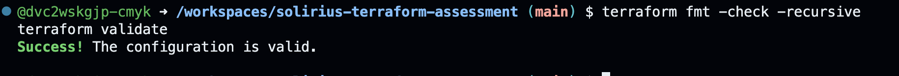
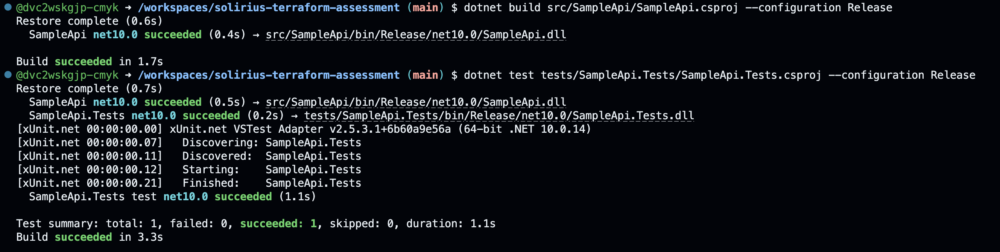

# Solirius — Terraform Technical Assessment

## Overview

For this assessment, I've put together a Terraform configuration for hosting a .NET 10 Web API on Azure App Service, alongside an Azure SQL S0 database.

I've also included a GitHub Actions workflow to validate the infrastructure configuration, build and test the application, and support deployment to Azure when the required environment and credentials are available.

I've approached this from an infrastructure architecture and delivery perspective. I wanted to keep the solution straightforward while separating the components so they can be configured and developed independently.

The Terraform configuration and application have been validated locally using GitHub Codespaces. I haven't carried out a live Azure deployment.

## 1. My approach

I split the infrastructure into two Terraform modules:

- `modules/app-service` — Linux App Service Plan and Web App.
- `modules/sql-database` — Azure SQL logical server and database.

The root `main.tf` brings these modules together, creates the resource group and passes the required inputs between components.

I chose this structure to keep the application hosting and database infrastructure separate. It also means changes to one component don't necessarily require changes to the other.

The configuration supports different deployment environments through variables for the environment, Azure region, resource naming suffix and hosting sizes.

The defaults are UK South, a B1 App Service Plan and the requested S0 SQL database.

## 2. Infrastructure and connectivity

The App Service module defines a Linux App Service Plan and Web App, with HTTPS enforced and the runtime set to .NET 10.

The SQL module defines an Azure SQL logical server, with a minimum TLS version of 1.2, and an S0 database by default.

The SQL module provides outputs for the server address and database name. The root configuration passes those into the App Service module as application settings:

- `Database__Server`
- `Database__Name`

This demonstrates how Terraform modules can exchange information without duplicating resource values.

The App Service module also exposes the Web App name, URL and Azure resource ID, which are made available through root Terraform outputs.

The sample Web API doesn't currently connect to SQL. A working connection would still require application database-access code, authentication, permissions and network access.

For a customer environment, I'd review using App Service VNet integration, an Azure SQL private endpoint, private DNS and managed identity with Microsoft Entra authentication. That would provide a more controlled approach than broadly allowing public SQL access.

## 3. Terraform reusability

I've made the deployment settings configurable rather than fixing all the values inside the modules.

The root configuration accepts:

| Variable | Purpose | Default |
|---|---|---|
| `environment` | Deployment environment: dev, staging or prod | `dev` |
| `location` | Azure region | `uksouth` |
| `name_suffix` | Lowercase suffix to distinguish resource names | Required |
| `app_service_sku` | App Service Plan pricing tier | `B1` |
| `database_sku` | Azure SQL database tier | `S0` |
| `sql_admin_username` | SQL administrator username | Required |
| `sql_admin_password` | SQL administrator password | Required, sensitive |

The `name_suffix` variable is used in resource naming to reduce collisions when different people deploy the configuration. It must contain between 3 and 12 lowercase letters or numbers.

For example, using `environment = "dev"` and `name_suffix = "team01"` produces an application name of `app-solirius-dev-team01`.

This doesn't guarantee a globally unique Azure name, so name availability would still need checking during a live deployment.

For separate development, staging and production deployments, I would use distinct configuration values, state keys and deployment controls.

## 4. Terraform state and security

I've configured Azure Blob Storage as the intended remote Terraform state backend.

The backend declaration is in `backend.tf`, with example settings in `backend.hcl.example`.

I chose Azure Blob Storage because it supports state locking using Blob leases. That helps prevent simultaneous Terraform operations from making conflicting changes against the same state.

The storage account and container must be created separately before the first live deployment. I would secure them using Microsoft Entra ID, appropriate role assignments, restricted access and storage security controls.

The SQL administrator password is marked as sensitive in Terraform. However, sensitive values can still be stored in Terraform state, so the state storage must be protected.

For a production implementation, I'd prefer to review Microsoft Entra authentication and managed identity to reduce reliance on SQL administrator credentials.

The remote backend configuration has not been tested against live Azure Storage.

## 5. Application build and CI/CD

The sample ASP.NET Core Web API is located in `src/SampleApi` and targets .NET 10.

An xUnit test project is included in `tests/SampleApi.Tests`. The temperature conversion test checks that 20°C converts to 68°F.

The GitHub Actions workflow is located at:

`.github/workflows/deploy.yml`

It contains two jobs:

**Terraform validation**

- Checks out the repository.
- Installs Terraform 1.17.2.
- Initialises Terraform without connecting to the Azure backend.
- Checks Terraform formatting.
- Validates the Terraform configuration.

**Application build and deployment**

- Checks out the repository.
- Installs .NET 10.
- Restores dependencies.
- Builds the Web API.
- Runs the automated tests.
- Publishes the application package.

Both jobs run automatically on relevant pushes to `main`, including changes to application code, tests, Terraform configuration or the workflow itself.

Azure authentication and deployment are currently restricted to manually triggered workflow runs.

This allows the automated validation and application tests to operate without Azure credentials. It also means a successful normal workflow run does not represent a successful Azure deployment.

The workflow uses OpenID Connect (OIDC) for Azure authentication and expects these GitHub secrets:

- `AZURE_CLIENT_ID`
- `AZURE_TENANT_ID`
- `AZURE_SUBSCRIPTION_ID`

It also expects the GitHub Actions variable `AZURE_WEBAPP_NAME` to match the Web App created by Terraform.

The Azure identity, federated credential, appropriate permissions and target application would need to exist before running a deployment.

For a production pipeline, I'd separate build and deployment into distinct jobs, retain the published build artifact, introduce deployment approvals and consider deployment slots and rollback procedures.

## 6. Validation and testing

I've completed the following checks locally in GitHub Codespaces.

### Terraform validation

```bash
terraform init -backend=false
terraform fmt -check -recursive
terraform validate
```

The configuration passed the local formatting and validation checks.



### Application build and testing

```bash
dotnet build src/SampleApi/SampleApi.csproj --configuration Release
dotnet test tests/SampleApi.Tests/SampleApi.Tests.csproj --configuration Release
```

Following the upgrade to .NET 10 and correction of the temperature conversion calculation, the application built successfully and the unit test passed.



The screenshots were captured during the assessment and should be read alongside the latest command results and GitHub Actions history.

These checks demonstrate local configuration validation and application testing. They do not establish that the infrastructure has been successfully deployed or that the application has connected to SQL.

## 7. Deployment instructions

### Prerequisites

A live deployment requires:

- Terraform 1.17.x and the AzureRM provider version specified in the repository.
- An Azure subscription and an identity with the required permissions.
- An Azure Storage Account and Blob container for remote state.
- A suitable naming suffix and available Azure resource names.
- SQL administrator credentials supplied securely.
- A configured GitHub OIDC identity if deploying through GitHub Actions.

The Terraform and provider requirements are declared in `versions.tf`, and the provider dependency lock file is committed as `.terraform.lock.hcl`.

### Local validation

From the repository root:

```bash
terraform init -backend=false
terraform fmt -check -recursive
terraform validate
```

These commands validate the configuration without needing access to the remote Azure backend.

### Azure infrastructure deployment

First create the Azure Storage Account and Blob container used for Terraform state, and configure the necessary access permissions.

Copy `backend.hcl.example` to `backend.hcl`, then replace the example storage details with the actual backend configuration.

Set the required Terraform input values securely. For example:

```bash
export TF_VAR_name_suffix="team01"
export TF_VAR_sql_admin_username="<username>"
export TF_VAR_sql_admin_password="<password>"
```

The SQL credentials should be supplied through an appropriate secure mechanism and not committed into Git.

Configure Azure authentication and the target subscription, then run:

```bash
terraform init -backend-config=backend.hcl
terraform plan
terraform apply
```

Review the plan before applying it.

After a successful deployment, the root outputs can provide the Web App name, URL and Azure resource ID.

### Application deployment

Configure GitHub Actions with the required Azure authentication secrets and set `AZURE_WEBAPP_NAME` to the Web App name returned by Terraform.

The application deployment can then be manually triggered through GitHub Actions.

These live deployment steps have not been executed as part of the assessment.

## 8. Alternative hosting — Azure Functions

The assessment also asks for an alternative approach using Azure Functions.

Rather than implement a second untested hosting platform, I've documented how I would approach the migration.

I would introduce a separate Terraform hosting module containing an Azure Function App, an appropriate hosting plan and the required storage resources.

I would assess Flex Consumption against Premium hosting based on workload, network connectivity, scaling requirements and operational costs.

The existing .NET API would need adapting to the Azure Functions isolated worker model, with HTTP-triggered functions replacing the relevant API controller endpoints.

I would retain the existing SQL module, although I would review how the Functions application authenticates to and connects with the database.

The deployment workflow would also need changing to build and publish the Functions application and deploy it to the correct Function App.

Before selecting this option, I'd compare cold-start behaviour, scaling, networking, monitoring and the operational requirements of the application.

This remains a documented migration approach rather than an implemented or validated second hosting option.

## 9. Assumptions and trade-offs

I've made several decisions to keep the assessment focused:

- App Service was selected as a straightforward hosting option for a small .NET Web API.
- The requested S0 SQL database remains the default.
- Terraform modules separate application hosting and database infrastructure.
- The sample API demonstrates build and test automation, not functional SQL integration.
- Remote state is configured but requires an existing Azure Storage backend.
- Azure deployment is manual because the required subscription, identity and application have not been configured for a live test.
- The Azure Functions option is documented as an alternative design, rather than implemented alongside App Service.

These choices are suitable for demonstrating the initial approach, but I wouldn't consider this a complete production deployment.

## 10. What I'd improve for a live environment

My next priorities would be:

- **Security and connectivity:** Complete the managed identity, SQL permissions, private networking and secrets design.
- **Deployment controls:** Separate build and deployment jobs, introduce approvals, and add a tested rollback process.
- **Environment management:** Use separate environment configurations, state keys and GitHub deployment environments.
- **Monitoring:** Add Application Insights, diagnostic logging, alerting and operational monitoring.
- **Testing:** Add API-level, database integration and end-to-end deployment tests.
- **Resilience:** Review availability, database backup and recovery requirements, and appropriate production hosting tiers.
- **Alternative hosting:** Implement and validate the Azure Functions module if both hosting options are required.

## Summary

The assessment includes Terraform modules for Azure App Service and Azure SQL, configurable deployment settings, root and module outputs, remote state configuration, a .NET 10 Web API and automated GitHub Actions checks.

The Terraform configuration passes local validation, and the .NET 10 application builds and passes its unit test.

I haven't deployed the solution into Azure, so live infrastructure provisioning, database connectivity and end-to-end deployment remain untested.
